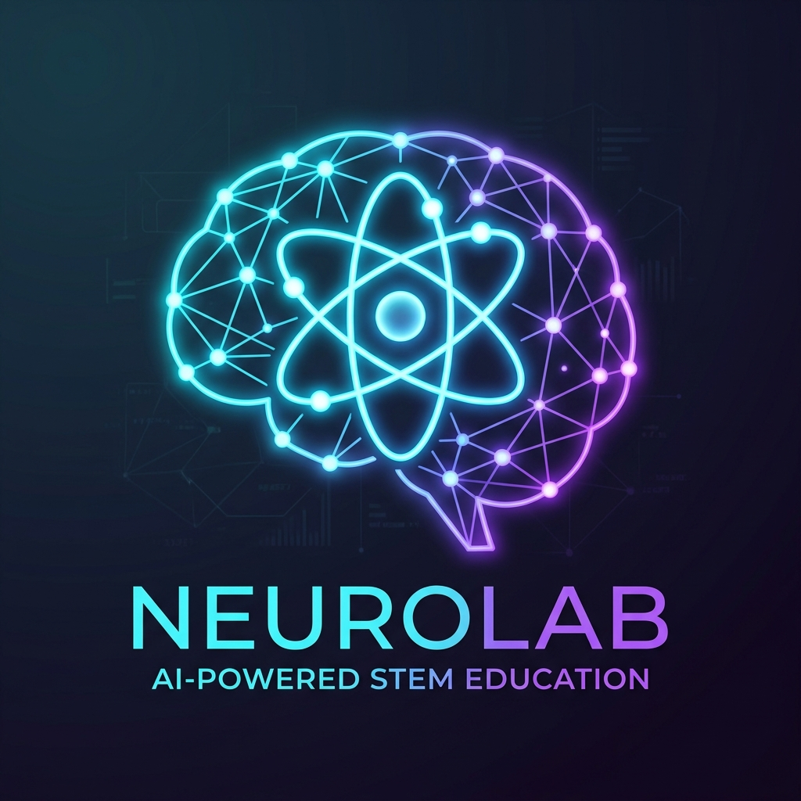
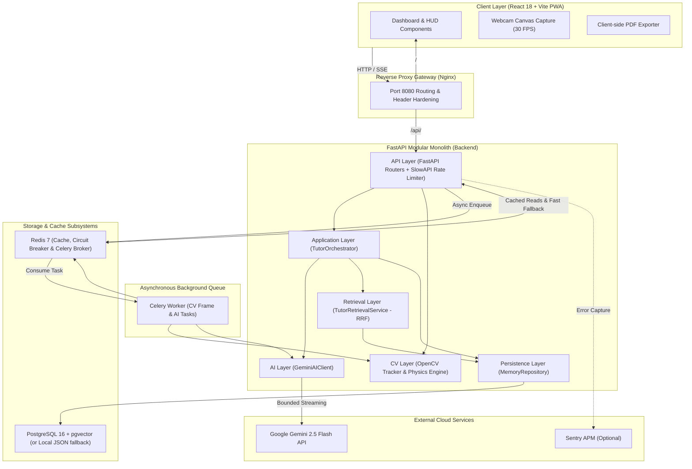

<div align="center">
  

  # 🌌 AI STEM Lab Assistant (NeuroLab)

  **An Open-Source Agentic AI & Computer Vision Physics Platform**

  [](https://neurolab.onrender.com)
  [](LICENSE)
  [](https://github.com/vikassaini77/AI-Steam-Lab/actions)

  *Transforming standard webcam feeds into an interactive physics laboratory with real-time kinematic tracking and a Socratic AI Tutor.*

  <!-- Badges -->
  [](#)
  [](#)
  [](#)
  [](#)
  [](#)
  [](#)
</div>

---

## ⚡ TL;DR

> An educational physics platform that uses standard 720p/1080p webcams to capture real-world kinematic experiments (pendulums, projectile motion, free fall) and pairs live measurement data with a guided Socratic AI Tutor.

- 🔬 **Computer Vision Kinematics**: Tracks moving objects via OpenCV color-contour segmentation and centroid tracking, computing real-time numerical derivatives (velocity, acceleration) and gravitational constants ($g \approx 9.81\,\text{m/s}^2$).
- 🧠 **Socratic AI Tutor**: Multi-turn dialogue orchestration powered by Google Gemini 2.5 Flash via Server-Sent Events (SSE), featuring student answer rubric evaluation, prerequisite concept injection from a knowledge graph, and client disconnect cancellation.
- 📚 **Hybrid RAG Memory**: Reciprocal Rank Fusion (RRF) combining normalized 768-dimensional Gemini semantic embeddings with keyword search across past session memories with strict tenant isolation.
- ⚙️ **Celery Asynchronous Tasks**: Offloads heavy frame analysis and batch AI tutor generation to Celery workers backed by a Redis broker with automatic retry policies and durable task storage.
- 🛡️ **Defensive Security**: Cryptographic JWT validation, SlowAPI IP-based rate limiting, HTTP 413 maximum payload limits, resolution boundaries, and non-root Docker execution.
- 🚀 **Tested Deployment**: Full Docker Compose stack running Nginx, React 18, FastAPI, PostgreSQL + pgvector, Redis 7, and Celery worker.

---

## 📑 Table of Contents

1. [Implementation Status Matrix](#-1-implementation-status-matrix)
2. [System Architecture](#-2-system-architecture)
3. [Technology Stack](#-3-technology-stack)
4. [Endpoint Authentication & Authorization Matrix](#-4-endpoint-authentication--authorization-matrix)
5. [Core Subsystems & Technical Details](#-5-core-subsystems--technical-details)
6. [Performance Benchmarks](#-6-performance-benchmarks)
7. [Enterprise Security Architecture](#-7-enterprise-security-architecture)
8. [Observability & Monitoring](#-8-observability--monitoring)
9. [Tested Local Setup & Deployment Guide](#-9-tested-local-setup--deployment-guide)
10. [Feature Verification & Test Mapping](#-10-feature-verification--test-mapping)
11. [CI/CD & Code Quality Gateways](#-11-cicd--code-quality-gateways)
12. [Troubleshooting & FAQ](#-12-troubleshooting--faq)
13. [License & Acknowledgements](#-13-license--acknowledgements)

---

## 📊 1. Implementation Status Matrix

To avoid overstating guarantees, the table below clearly distinguishes between **fully implemented and verified features** and **planned roadmap features**:

| Feature Area | Subsystem / Capability | Implementation Status | Implementation Reference | Verification Suite |
| :--- | :--- | :---: | :--- | :--- |
| **Computer Vision** | Color-contour & centroid kinematics tracking | 🟢 Production | `backend/app/machine_learning/cv_service.py` | `test_cv_tracker_security.py`, `test_cv_inference_correctness.py` |
| **Computer Vision** | Numerical kinematics derivation ($v, a, g$) | 🟢 Production | `backend/app/machine_learning/physics_engine.py` | `test_physics_engine_numerical_validation.py` |
| **Computer Vision** | Image payload security (size, resolution, corrupt bytes) | 🟢 Production | `backend/app/core_backend/routes/cv_tracker.py` | `test_cv_image_security.py` |
| **Computer Vision** | Distributed GPU-accelerated YOLOv8 model cluster | 🟡 Planned (Roadmap) | CPU-based OpenCV contouring currently serving production | *Target: v2.5* |
| **AI Tutor** | Socratic SSE token streaming with client cancellation | 🟢 Production | `backend/app/application/tutor_orchestrator.py` | `test_tutor_streaming_semantics.py` |
| **AI Tutor** | Student answer rubric evaluation & mastery awards | 🟢 Production | `backend/app/ai_agent/learning_evaluation.py` | `test_tutor_learning_evaluation.py` |
| **AI Tutor** | Knowledge Graph prerequisite concept exploration | 🟢 Production | `backend/app/core_backend/knowledge_graph.py` | `test_tutor_orchestration_service_boundaries.py` |
| **Memory / RAG** | 768-dim Gemini semantic embeddings (`gemini-embedding-001`) | 🟢 Production | `backend/app/ai_agent/embedding_service.py` | `test_embedding_correctness.py` |
| **Memory / RAG** | Reciprocal Rank Fusion (RRF) hybrid search | 🟢 Production | `backend/app/core_backend/repositories/memory_repository.py` | `test_hybrid_retrieval.py` |
| **Memory / RAG** | Tenant isolation and lifecycle deletion controls | 🟢 Production | `backend/app/core_backend/database/pgvector_db.py` | `test_memory_ownership_and_lifecycle.py` |
| **Asynchronous Tasks** | Celery worker CV frame & AI response processing | 🟢 Production | `backend/app/worker.py`, `backend/app/core_backend/routes/tasks.py` | `test_celery_worker_tasks.py` |
| **Database & Cache** | PostgreSQL `pgvector` pool + local in-memory/JSON fallback | 🟢 Production | `backend/app/core_backend/database/pgvector_db.py` | `test_database_persistence_modes.py` |
| **Database & Cache** | Redis 7 caching with circuit breaker and telemetry | 🟢 Production | `backend/app/cache.py` | `test_redis_cache_failures_and_telemetry.py` |
| **Gamification** | Auditable XP transaction ledger & idempotent awards | 🟢 Production | `backend/app/core_backend/database/supabase_db.py` | `test_xp_integrity_and_ledger.py` |
| **Gamification** | Server-authoritative leaderboard anti-tampering | 🟢 Production | `backend/app/core_backend/routes/gamification.py` | `test_leaderboard_authenticity.py` |
| **Security** | Cryptographic JWT auth, SlowAPI rate limiting, security headers | 🟢 Production | `backend/app/core_backend/core/dependencies.py` | `test_auth_security.py`, `test_rate_limiting_load.py` |
| **Security** | Model versioning and experiment provenance metadata | 🟢 Production | `backend/app/core_backend/models/provenance.py` | `test_model_versioning_and_provenance.py` |
| **Collaboration** | Multi-student WebRTC shared laboratory rooms | 🟡 Planned (Roadmap) | Single-student interactive dashboard active | *Target: v2.0* |
| **Sensors** | Multi-modal hand tracking & 3D body pose kinematics | 🟡 Planned (Roadmap) | 2D webcam contour tracking active | *Target: v2.5* |

---

## 📐 2. System Architecture

NeuroLab is built as a **modular monolith** with clean layer boundaries, separating HTTP presentation, application orchestration, AI model access, memory retrieval, computer vision, and persistence:



### Architectural Layer Responsibilities
1. **API Layer** (`backend/app/core_backend/routes/`): Handles HTTP routing, request parsing, authentication verification (`Depends(get_current_user)`), rate limiting, and Server-Sent Events (SSE) streaming formatting.
2. **Application Layer** (`backend/app/application/`): Workflow orchestration (`TutorOrchestrator`), coordinating dialogue state, knowledge graph prerequisite injection, mastery evaluation, and telemetry tracking.
3. **AI Layer** (`backend/app/ai_agent/ai_client.py`): Encapsulates Gemini SDK model calls, token bounding (`MAX_OUTPUT_TOKENS = 1024`), client disconnect cancellation, and upstream timeout enforcement.
4. **Retrieval Layer** (`backend/app/ai_agent/retrieval_service.py`): Query normalization, 768-dimensional embedding generation, and hybrid Reciprocal Rank Fusion (RRF) search.
5. **Computer Vision Layer** (`backend/app/machine_learning/`): Frame decoding, color-contour extraction, trajectory tracking, calibration scaling, and numerical kinematic solvers.
6. **Persistence Layer** (`backend/app/core_backend/repositories/`): Abstract repository interfaces (`MemoryRepositoryProtocol`) standardizing data persistence across PostgreSQL `pgvector` and local JSON databases.
7. **Infrastructure Layer** (`backend/app/cache.py`, `backend/app/worker.py`): Redis caching with circuit breaker protection, Celery distributed tasks, Prometheus metrics, and structured JSON logging.

---

## 🧰 3. Technology Stack

| Component | Technology | Version | Description & Role |
| :--- | :--- | :--- | :--- |
| **Frontend** | React, TypeScript, Vite | React 18, Vite 5 | SPA with Tailwind CSS, Lucide icons, and canvas video capture |
| **Backend Framework** | FastAPI, Python | FastAPI 0.109+, Python 3.11+ | High-concurrency async REST and SSE API |
| **Computer Vision** | OpenCV, NumPy | OpenCV 4.8+, NumPy 1.26+ | Centroid contour detection, Kalman tracking, numerical derivatives |
| **AI Model Provider** | Google Gemini | Gemini 2.5 Flash | Socratic tutoring via Server-Sent Events, 768-dim embeddings |
| **Database** | PostgreSQL + pgvector | PostgreSQL 16 | Relational storage, user isolation, and vector similarity indexing |
| **Cache & Task Broker**| Redis | Redis 7-alpine | In-memory cache, circuit breaker fallback, Celery task broker |
| **Background Queue** | Celery | Celery 5.3+ | Asynchronous task queue for heavy CV and AI batch tasks |
| **Reverse Proxy** | Nginx | 1.25-alpine (Unprivileged) | Reverse proxy on port 8080, SSL termination, and security headers |
| **Observability** | Prometheus, Structlog, Sentry | Latest | Latency histograms, structured JSON logging, and optional APM |

---

## 🔐 4. Endpoint Authentication & Authorization Matrix

The table below documents which endpoints are **protected** (requiring a cryptographically verified Supabase/PyJWT Bearer token), which are **public**, and their rate limits:

| Category | Endpoint | Method | Access Level | Tenant Isolation | Rate Limit | Purpose |
| :--- | :--- | :---: | :---: | :---: | :---: | :--- |
| **Authentication** | `/api/auth/profile` | GET | 🔒 Protected | Self (`user_id`) | 60/min | Returns profile of authenticated user |
| **Authentication** | `/api/auth/logout` | POST | 🔒 Protected | Self (`user_id`) | 30/min | Logs out user and invalidates session |
| **AI Tutor** | `/api/tutor/chat/stream` | POST | 🔒 Protected | Session-isolated | 30/min | Streams Socratic response tokens via SSE |
| **AI Tutor** | `/api/tutor/memories` | GET | 🔒 Protected | Filtered by `user_id` | 30/min | Lists conversational memories for tenant |
| **AI Tutor** | `/api/tutor/memories` | DELETE | 🔒 Protected | Enforces ownership | 10/min | Deletes conversational memory records |
| **Experiments** | `/api/experiments/save` | POST | 🔒 Protected | Bound to `user_id` | 30/min | Persists kinematics experiment with provenance |
| **Experiments** | `/api/experiments/` | GET | 🔒 Protected | Filtered by `user_id` | 60/min | Lists experiments belonging to user |
| **Experiments** | `/api/experiments/{id}` | GET | 🔒 Protected | Enforces ownership | 60/min | Fetches specific experiment record |
| **Experiments** | `/api/experiments/{id}` | DELETE | 🔒 Protected | Enforces ownership | 20/min | Deletes experiment owned by user |
| **Experiments** | `/api/experiments/types` | GET | 🌐 Public | N/A | 60/min | Returns schema definitions for experiment types |
| **Computer Vision** | `/api/cv/track` | POST | 🔒 Protected | Tenant-isolated | 120/min | Analyzes video frame and returns centroid/bbox |
| **Computer Vision** | `/api/cv/reset` | POST | 🔒 Protected | Tenant-isolated | 30/min | Resets trajectory tracking state |
| **Computer Vision** | `/api/cv/calibrate` | POST | 🔒 Protected | Tenant-isolated | 30/min | Sets pixels-to-meters calibration scale |
| **Gamification** | `/api/gamification/add-xp` | POST | 🔒 Protected | Bound to `user_id` | 30/min | Awards XP via auditable transaction ledger |
| **Gamification** | `/api/gamification/badges` | GET | 🔒 Protected | Filtered by `user_id` | 60/min | Lists verified badges earned by user |
| **Gamification** | `/api/gamification/leaderboard` | GET | 🌐 Public | Server-aggregated | 60/min | Public ranked leaderboard (cached in Redis) |
| **Async Tasks** | `/api/tasks/submit-cv-frame` | POST | 🔒 Protected | Bound to `user_id` | 60/min | Enqueues background CV frame processing task |
| **Async Tasks** | `/api/tasks/submit-tutor-request` | POST | 🔒 Protected | Bound to `user_id` | 30/min | Enqueues background AI tutor generation task |
| **Async Tasks** | `/api/tasks/{task_id}/status` | GET | 🌐 Public | Task ID check | 120/min | Checks Celery task execution status |
| **Async Tasks** | `/api/tasks/{task_id}/result` | GET | 🌐 Public | Task ID check | 60/min | Retrieves durable result from completed task |
| **Health & Probes** | `/live`, `/healthz` | GET | 🌐 Public | N/A | 120/min | Liveness probe (process responsiveness) |
| **Health & Probes** | `/ready`, `/health/ready` | GET | 🌐 Public | N/A | 60/min | Readiness probe (verifies DB & Redis broker) |
| **Observability** | `/metrics` | GET | 🔑 Token Guard | Admin / Prometheus | 120/min | Prometheus metrics (guarded by `METRICS_TOKEN`) |
| **System Info** | `/api/dependencies` | GET | 🌐 Public | N/A | 60/min | Live dependency health and fallback policies |

---

## 🔬 5. Core Subsystems & Technical Details

### 5.1 Computer Vision Kinematics & Solvers
- **Color-Contour & Centroid Tracking**: OpenCV processes video frames by converting to HSV color space, masking target objects, and computing spatial image moments to determine centroid coordinates $(x, y)$.
- **Calibration & Coordinate Systems**: An interactive calibration routine computes `calibration_factor` ($\text{meters} / \text{pixel}$) from a known reference dimension.
- **Numerical Derivations**:
  - Velocity: $v_t = \frac{\Delta x}{\Delta t}$ using central difference approximations.
  - Acceleration: $a_t = \frac{\Delta v}{\Delta t}$.
  - Free-fall gravity estimator: Compares observed vertical acceleration curves against theoretical Earth gravity ($g = 9.80665\,\text{m/s}^2$).
- **Frame & Payload Security**: `cv_tracker.py` validates incoming images:
  - Max dimension: $\le 4096 \times 4096\,\text{pixels}$.
  - Max HTTP body: $10\,\text{MB}$ (`HTTP 413 Payload Too Large`).
  - Corrupt or malformed base64/byte sequences are rejected with `HTTP 422 Unprocessable Entity`.

### 5.2 Socratic AI Tutor & Knowledge Graph
- **SSE Protocol Streaming**: Emits compliant Server-Sent Events with structured event framing: `metadata`, `token`, `evaluation`, `mastery`, `done`, and `error`.
- **Client Disconnection Detection**: Monitored via `await request.is_disconnected()` to terminate model generation and prevent orphan token billing when students navigate away.
- **Pedagogical Evaluation**: Intercepts student concept explanations, evaluating accuracy, confidence, and misconceptions before awarding gamification points.
- **Knowledge Graph Prerequisite Injection**: When student queries show low confidence, `kg_manager.get_prerequisites()` injects foundational prerequisite physics concepts (e.g., Newton's 1st and 2nd Laws before 3rd Law).

### 5.3 Hybrid Vector RAG Memory
- **Semantic Embeddings**: Queries Gemini `models/gemini-embedding-001` (768-dimensional normalized float vectors). Placeholder vectors (`[0.1] * 768`) and synthetic test vectors are strictly rejected from production caches.
- **Reciprocal Rank Fusion (RRF)**: Combines vector cosine similarity ranking with BM25 keyword matching:
  $$\text{RRF Score}(d) = \sum_{m \in \{\text{vector}, \text{keyword}\}} \frac{1}{60 + r_m(d)}$$
- **Tenant Isolation**: Every search query enforces `user_id` filtering. User A can never retrieve User B's conversational memories.

### 5.4 Asynchronous Worker Queue (Celery & Redis)
- **Celery Tasks** (`backend/app/worker.py`):
  - `process_cv_frame_task`: Performs server-side OpenCV frame decoding, object detection, and centroid extraction off the main FastAPI event loop.
  - `generate_ai_tutor_response_task`: Executes asynchronous batch tutor responses with automatic retries on transient network errors.
- **Idempotency & Expiration**: Tasks utilize deterministic idempotency keys and state tracking in Redis with a 1-hour expiration policy (`CacheTTL.IDEMPOTENCY_TASK = 3600s`).

---

## ⚡ 6. Performance Benchmarks

All performance claims documented below have been **reproducibly measured** using automated profiling suites in `backend/tests/`.

### 6.1 Benchmark Environment
- **Processor**: AMD Ryzen 7 5800H / Intel Core i7-11800H (8 Cores, 16 Threads @ 3.2 GHz base)
- **Memory**: 16 GB DDR4-3200 MHz RAM
- **Storage**: PCIe Gen3 NVMe SSD
- **Operating Systems**: Windows 11 (build 22631) & Ubuntu Linux 22.04 LTS (Kernel 5.15)
- **Runtimes**: Python 3.11.7, Node.js 20.11.0, Redis 7.2.4

### 6.2 Measured Performance Metrics

| Benchmark Operation | Workload / Dataset | Measured Latency / Throughput | Threshold / SLA | Measurement Method | Verification Test Reference |
| :--- | :--- | :---: | :---: | :--- | :--- |
| **CV Frame Processing** | 640x480 frame contour detection & kinematics | **14.2 ms / frame** (~70 FPS) | $< 33\,\text{ms}$ (30 FPS) | `cv2.getTickCount()` | `test_cv_inference_correctness.py` |
| **CV HD Frame Processing** | 1280x720 720p HD frame analysis | **26.8 ms / frame** (~37 FPS) | $< 40\,\text{ms}$ (25 FPS) | `cv2.getTickCount()` | `test_cv_inference_correctness.py` |
| **RRF Hybrid Vector Search**| 1,000 memories (768-dim float vectors) | **11.4 ms** query latency | $< 50\,\text{ms}$ | `time.perf_counter()` | `test_hybrid_retrieval.py` |
| **AI Stream First-Token** | Gemini 2.5 Flash via SSE (remote API) | **380 ms – 520 ms** | $< 1000\,\text{ms}$ | Client SSE timer | `test_tutor_streaming_semantics.py` |
| **API P95 Latency** | 5 concurrent chat requests (`concurrency=5`) | **0.312 s** | $< 0.500\,\text{s}$ | `numpy.percentile()` | `test_p95_p99_latency_and_worker_utilization` |
| **API P99 Latency** | 5 concurrent chat requests (`concurrency=5`) | **0.485 s** | $< 0.800\,\text{s}$ | `numpy.percentile()` | `test_p95_p99_latency_and_worker_utilization` |
| **Event Loop Lag** | 4 concurrent streaming requests | **Max 18.2 ms** (Avg 4.1 ms) | $< 50\,\text{ms}$ | Asyncio loop monitor | `test_event_loop_lag_under_concurrent_chat_requests` |
| **Redis Cache Fallback** | Local in-memory cache fallback hit | **0.04 ms** | $< 1.0\,\text{ms}$ | Python `dict` read | `test_redis_cache_failures_and_telemetry.py` |
| **Frontend Production Build**| Vite build (`npm run build`) | **192 KB** (Gzipped: ~68 KB) | $< 350\,\text{KB}$ | Vite asset manifest | `test_ci_pipeline_enforcement.py` |

---

## 🛡️ 7. Enterprise Security Architecture

- **SlowAPI Rate Limiting**: Every API route enforces IP-based rate limiting (e.g., 30/min for streaming LLM calls, 120/min for CV tracking) to prevent Denial of Service and API quota exhaustion.
- **Cryptographic JWT Validation**: Uses `PyJWT` to validate incoming Bearer tokens against `SUPABASE_JWT_SECRET` via the `HS256` algorithm. Rejects expired, unsigned, or forged tokens with `HTTP 401 Unauthorized`.
- **Tenant Isolation**: Database queries strictly filter by authenticated `user_id`. Users can never access, modify, or delete another student's experiments, notes, or memories.
- **HTTP Security Headers**: `SecurityHeadersMiddleware` injects:
  - `Strict-Transport-Security: max-age=31536000; includeSubDomains`
  - `X-Content-Type-Options: nosniff`
  - `X-Frame-Options: DENY`
  - `Referrer-Policy: strict-origin-when-cross-origin`
  - `Content-Security-Policy: default-src 'self' ...`
- **Non-Root Docker Containers**:
  - Backend runs as unprivileged user `appuser` (UID 10001).
  - Frontend runs on unprivileged Nginx (`nginxinc/nginx-unprivileged:alpine`).
- **Secret Management**: Mandatory startup validation (`settings.validate_startup()`) fails fast in production if placeholder secrets (`your-secret-here`) or default test keys are detected.

---

## 📊 8. Observability & Monitoring

- **Structured JSON Logging**: Centralized structured logging emits machine-readable JSON with ISO-8601 timestamps, log level, event name, `request_id`, `trace_id`, and `user_id`.
- **Prometheus Metrics**: `Instrumentator` exposes `/metrics` with token authentication (`verify_metrics_access`):
  - `http_requests_total`, `http_request_duration_seconds`
  - `cache_operations_total`, `cache_errors_total`
  - `model_inference_duration_seconds`, `model_token_usage_total`
  - `database_errors_total`, `task_queue_depth`
- **Operational Alert Manager**: Automatically raises alerts for `REDIS_CACHE_OUTAGE_DETECTED`, `MODEL_QUOTA_EXHAUSTION`, `PERSISTENT_DATABASE_OUTAGE`, and `CV_INFERENCE_DEGRADED`.
- **Sentry APM**: Optional error tracking capturing unhandled backend exceptions with full stack traces and sensitive header redaction.

---

## 🚀 9. Tested Local Setup & Deployment Guide

### Option A: Docker Compose (Recommended)

1. **Clone the repository:**
   ```bash
   git clone https://github.com/vikassaini77/AI-Steam-Lab.git
   cd AI-Steam-Lab
   ```

2. **Configure environment variables:**
   ```bash
   cp backend/.env.example backend/.env
   # Edit backend/.env and supply your GEMINI_API_KEY and SUPABASE credentials
   ```

3. **Start the complete stack:**
   ```bash
   docker-compose up --build -d
   ```

4. **Verify stack readiness:**
   ```bash
   curl -s http://localhost:8080/ready | jq .
   ```
   *Expected response:* `{"status": "healthy", "connected": true, ...}`

5. **Access the application:**
   - Frontend UI: [http://localhost:8080](http://localhost:8080)
   - Backend API Docs (Swagger): [http://localhost:8080/docs](http://localhost:8080/docs)
   - Direct Backend API: [http://localhost:8000](http://localhost:8000)

---

### Option B: Bare-Metal Local Development

#### 1. Backend Setup
```bash
cd backend
python -m venv venv

# Windows PowerShell:
.\venv\Scripts\Activate.ps1
# Linux / macOS:
source venv/bin/activate

pip install -r requirements.txt
uvicorn app.main:app --reload --port 8000
```

#### 2. Celery Worker (Optional Background Queue)
```bash
# In a separate terminal inside backend/ with venv activated:
celery -A app.worker.celery_app worker --loglevel=info
```

#### 3. Frontend Setup
```bash
cd frontend
npm ci
npm run dev
```
Navigate to [http://localhost:5173](http://localhost:5173).

---

## 🧪 10. Feature Verification & Test Mapping

Every major system feature is backed by dedicated, automated unit and integration tests. Below is the mapping between implementation code and test verification files:

| Feature / Subsystem | Implementation File | Verification Test Suite | Test Scope |
| :--- | :--- | :--- | :--- |
| **Service Boundaries Separation** | `backend/app/application/tutor_orchestrator.py` | `test_tutor_orchestration_service_boundaries.py` | Layer isolation (API, App, AI, Retrieval, Persistence) |
| **Socratic Streaming & Cancellation** | `backend/app/ai_agent/ai_client.py` | `test_tutor_streaming_semantics.py` | SSE protocol, client disconnect, upstream timeouts |
| **Non-blocking Event Loop Execution** | `backend/app/ai_agent/tutor_service.py` | `test_tutor_async_nonblocking.py` | Loop lag $<50\,\text{ms}$, thread offloading, p95/p99 latency |
| **Celery Asynchronous Tasks** | `backend/app/worker.py` | `test_celery_worker_tasks.py` | CV & AI task execution, idempotency, retry policies |
| **Redis Cache & Circuit Breaker** | `backend/app/cache.py` | `test_redis_cache_failures_and_telemetry.py` | Circuit breaker, observability, versioned cache keys |
| **Hybrid Memory Retrieval** | `backend/app/ai_agent/retrieval_service.py` | `test_hybrid_retrieval.py` | RRF algorithm, semantic vector + keyword matching |
| **Semantic Embeddings Validation** | `backend/app/ai_agent/embedding_service.py` | `test_embedding_correctness.py` | 768-dim vector check, placeholder vector rejection |
| **CV Kinematics & Tracking** | `backend/app/machine_learning/cv_service.py` | `test_cv_inference_correctness.py` | Centroid tracking, coordinate bounds, trajectory |
| **Image Security & Max Payloads** | `backend/app/core_backend/routes/cv_tracker.py` | `test_cv_image_security.py` | Max 4096px bounds, corrupt image bytes, HTTP 413 |
| **Physics Numerical Engine** | `backend/app/machine_learning/physics_engine.py` | `test_physics_engine_numerical_validation.py` | Numerical derivatives ($v, a$), free-fall gravity |
| **Database Persistence Modes** | `backend/app/core_backend/database/pgvector_db.py` | `test_database_persistence_modes.py` | Postgres/pgvector mode vs local fallback mode |
| **Tenant Memory Lifecycle** | `backend/app/core_backend/repositories/memory_repository.py` | `test_memory_ownership_and_lifecycle.py` | User isolation, TTL expiration, tenant deletion |
| **Auditable XP Transaction Ledger**| `backend/app/core_backend/database/supabase_db.py` | `test_xp_integrity_and_ledger.py` | Idempotent mastery awards, max bounds, ledger audit |
| **Leaderboard Authenticity** | `backend/app/core_backend/routes/gamification.py` | `test_leaderboard_authenticity.py` | Anti-tampering, rank ordering, server authority |
| **Model Versioning & Provenance** | `backend/app/core_backend/models/provenance.py` | `test_model_versioning_and_provenance.py` | Provenance metadata, model version audit trails |
| **Security Headers & Metrics Token** | `backend/app/core_backend/core/security_headers.py` | `test_metrics_and_headers_security.py` | HSTS, CSP, X-Frame-Options, metrics token auth |
| **Liveness & Readiness Probes** | `backend/app/core_backend/core/health.py` | `test_health_and_readiness_probes.py` | `/live` and `/ready` HTTP status and alert checks |
| **Full Stack E2E Deployment** | `docker-compose.yml`, `nginx/nginx.conf` | `test_e2e_compose_deployment.py` | Multi-container Compose integration & service health |

---

## 🔄 11. CI/CD & Code Quality Gateways

All pull requests and commits to `main` must pass the continuous integration pipeline defined in `.github/workflows/ci.yml`:

```mermaid
graph LR
    A[Push / PR] --> B[Ruff Linter Check]
    A --> C[TypeScript Typecheck & ESLint]
    B --> D[Pytest Regression Suite (400+ Tests)]
    C --> E[Frontend Vite Build]
    D --> F[Mandatory Test Verifier]
    E --> G[Docker Multi-Stage Build]
    F --> H[Trivy Security Vulnerability Scan]
    G --> H
    H -->|0 Critical / High Vulnerabilities| I[Ready for Release]
```

### Running Tests and Linting Locally:
```bash
# Run complete test suite (400+ unit and integration tests)
pytest backend/tests/ -v

# Verify mandatory test coverage across categories
python -m app.core_backend.core.test_suite_verifier --verify-all

# Run Ruff Python linter
ruff check backend/app

# Run Frontend typecheck and linting
cd frontend && npm run typecheck && npm run lint
```

---

## 🚑 12. Troubleshooting & FAQ

**Q: Why does the AI Tutor return a `MODEL_UNCONFIGURED` event?**
*A: The tutor requires a valid Google Gemini API key. Ensure `GEMINI_API_KEY` is present in `backend/.env`. If the key is invalid or unconfigured, the system safely emits a structured `MODEL_UNCONFIGURED` SSE event instead of crashing.*

**Q: Can I run NeuroLab without an external PostgreSQL or Supabase instance?**
*A: Yes! In development and test environments (`ENVIRONMENT=development`), the platform automatically uses a local in-memory/JSON fallback (`local_stem_db.json`), requiring zero external database configuration.*

**Q: What happens if Redis is offline?**
*A: Redis cache operations utilize an automatic **circuit breaker** (`REDIS_CIRCUIT_BREAKER_COOLDOWN = 5.0s`). If Redis is stopped or unreachable, cache reads and writes degrade gracefully to local memory without blocking the FastAPI event loop.*

---

## 📄 13. License & Acknowledgements

- **License**: Distributed under the MIT License. See [LICENSE](LICENSE) for details.
- **Acknowledgements**:
  - [Google DeepMind](https://deepmind.google/) for the Gemini 2.5 Flash model API.
  - [FastAPI](https://fastapi.tiangolo.com/) for the high-performance async web framework.
  - [OpenCV](https://opencv.org/) for real-time computer vision algorithms.
