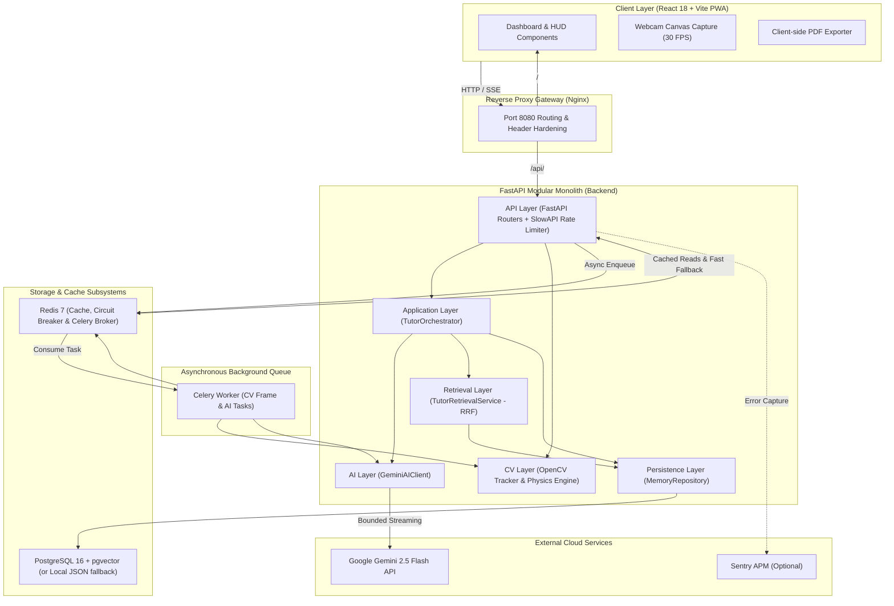

<div align="center">
  

  # 🌌 AI STEM Lab Assistant (NeuroLab)

  **An Open-Source Agentic AI & Computer Vision Physics Platform**

  [](https://neurolab.onrender.com)
  [](LICENSE)
  [](https://github.com/vikassaini77/AI-Steam-Lab/actions)

  *Transforming standard webcam feeds into an interactive physics laboratory with real-time kinematic tracking and a Socratic AI Tutor.*

  <!-- Badges -->
  [](#)
  [](#)
  [](#)
  [](#)
  [](#)
  [](#)
</div>

---

## ⚡ TL;DR

> An educational physics platform that uses standard 720p/1080p webcams to capture real-world kinematic experiments (pendulums, projectile motion, free fall) and pairs live measurement data with a guided Socratic AI Tutor.

- 🔬 **Computer Vision Kinematics**: Tracks moving objects via OpenCV color-contour segmentation and centroid tracking, computing real-time numerical derivatives (velocity, acceleration) and gravitational constants ($g \approx 9.81\,\text{m/s}^2$).
- 🧠 **Socratic AI Tutor**: Multi-turn dialogue orchestration powered by Google Gemini 2.5 Flash via Server-Sent Events (SSE), featuring student answer rubric evaluation, prerequisite concept injection from a knowledge graph, and client disconnect cancellation.
- 📚 **Hybrid RAG Memory**: Reciprocal Rank Fusion (RRF) combining normalized 768-dimensional Gemini semantic embeddings with keyword search across past session memories with strict tenant isolation.
- ⚙️ **Celery Asynchronous Tasks**: Offloads heavy frame analysis and batch AI tutor generation to Celery workers backed by a Redis broker with automatic retry policies and durable task storage.
- 🛡️ **Defensive Security**: Cryptographic JWT validation, SlowAPI IP-based rate limiting, HTTP 413 maximum payload limits, resolution boundaries, and non-root Docker execution.
- 🚀 **Tested Deployment**: Full Docker Compose stack running Nginx, React 18, FastAPI, PostgreSQL + pgvector, Redis 7, and Celery worker.

---

## 📑 Table of Contents

1. [Implementation Status Matrix](#-1-implementation-status-matrix)
2. [System Architecture](#-2-system-architecture)
3. [Technology Stack](#-3-technology-stack)
4. [Endpoint Authentication & Authorization Matrix](#-4-endpoint-authentication--authorization-matrix)
5. [Core Subsystems & Technical Details](#-5-core-subsystems--technical-details)
6. [Performance Benchmarks](#-6-performance-benchmarks)
7. [Enterprise Security Architecture](#-7-enterprise-security-architecture)
8. [Observability & Monitoring](#-8-observability--monitoring)
9. [Tested Local Setup & Deployment Guide](#-9-tested-local-setup--deployment-guide)
10. [Feature Verification & Test Mapping](#-10-feature-verification--test-mapping)
11. [CI/CD & Code Quality Gateways](#-11-cicd--code-quality-gateways)
12. [Troubleshooting & FAQ](#-12-troubleshooting--faq)
13. [License & Acknowledgements](#-13-license--acknowledgements)

---

## 📊 1. Implementation Status Matrix

To avoid overstating guarantees, the table below clearly distinguishes between **fully implemented and verified features** and **planned roadmap features**:

| Feature Area | Subsystem / Capability | Implementation Status | Implementation Reference | Verification Suite |
| :--- | :--- | :---: | :--- | :--- |
| **Computer Vision** | Color-contour & centroid kinematics tracking (HSV) | 🟢 Production | `backend/app/machine_learning/cv_service.py` | `test_cv_tracking_methods_genuine.py`, `test_cv_tracker_security.py` |
| **Computer Vision** | Lucas–Kanade optical flow tracking & recovery | 🟢 Production | `backend/app/machine_learning/cv_service.py` | `test_cv_tracking_methods_genuine.py` |
| **Computer Vision** | YOLOv8 object detection tracking with NMS | 🟢 Production | `backend/app/machine_learning/cv_service.py` | `test_cv_tracking_methods_genuine.py` |
| **Computer Vision** | Multi-camera & session tracking isolation | 🟢 Production | `backend/app/machine_learning/cv_service.py` | `test_cv_tracker_isolation_and_state.py` |
| **Computer Vision** | CV inference performance limits & timeouts | 🟢 Production | `backend/app/core_backend/routes/cv_tracker.py` | `test_cv_performance_limits.py` |
| **Computer Vision** | Numerical kinematics derivation ($v, a, g$) | 🟢 Production | `backend/app/machine_learning/physics_engine.py` | `test_physics_engine_numerical_validation.py` |
| **Computer Vision** | Image payload security (size, resolution, corrupt bytes) | 🟢 Production | `backend/app/core_backend/routes/cv_tracker.py` | `test_cv_image_security.py` |
| **AI Tutor** | Socratic SSE token streaming with client cancellation | 🟢 Production | `backend/app/application/tutor_orchestrator.py` | `test_tutor_streaming_semantics.py` |
| **AI Tutor** | Non-blocking streaming with thread offloading | 🟢 Production | `backend/app/ai_agent/tutor_service.py` | `test_tutor_nonblocking_streaming.py` |
| **AI Tutor** | Student answer rubric evaluation & mastery awards | 🟢 Production | `backend/app/ai_agent/learning_evaluation.py` | `test_tutor_learning_evaluation.py` |
| **AI Tutor** | Knowledge Graph prerequisite concept exploration | 🟢 Production | `backend/app/core_backend/knowledge_graph.py` | `test_tutor_orchestration_service_boundaries.py` |
| **Memory / RAG** | Single-flight deduplication & exponential retries | 🟢 Production | `backend/app/ai_agent/embedding_service.py` | `test_embedding_production_readiness.py` |
| **Memory / RAG** | Observable retrieval status (degraded / healthy / empty)| 🟢 Production | `backend/app/ai_agent/retrieval_service.py` | `test_tutor_retrieval_service_observability.py` |
| **Memory / RAG** | 768-dim Gemini semantic embeddings (`gemini-embedding-001`) | 🟢 Production | `backend/app/ai_agent/embedding_service.py` | `test_embedding_correctness.py` |
| **Memory / RAG** | Reciprocal Rank Fusion (RRF) hybrid search | 🟢 Production | `backend/app/core_backend/repositories/memory_repository.py` | `test_hybrid_retrieval.py` |
| **Memory / RAG** | Strict tenant isolation across all memory operations | 🟢 Production | `backend/app/core_backend/repositories/memory_repository.py` | `test_conversation_memory_tenant_isolation.py` |
| **Asynchronous Tasks** | Celery task ownership authorization & server identity | 🟢 Production | `backend/app/core_backend/routes/tasks.py` | `test_celery_worker_tasks.py` |
| **Asynchronous Tasks** | Durable Redis task metadata & idempotency storage | 🟢 Production | `backend/app/worker.py` | `test_celery_worker_tasks.py` |
| **Asynchronous Tasks** | Worker retry, transient error backoff & delivery safety | 🟢 Production | `backend/app/worker.py` | `test_celery_worker_tasks.py` |
| **Database & Cache** | Fail-closed production mode (`DatabasePersistenceError`)| 🟢 Production | `backend/app/core_backend/database/pgvector_db.py` | `test_database_persistence_modes.py` |
| **Database & Cache** | PostgreSQL ACID transaction XP ledger & rollback | 🟢 Production | `backend/app/core_backend/database/pgvector_db.py` | `test_xp_integrity_and_ledger.py` |
| **Database & Cache** | Advisory locks (`pg_advisory_lock`) & migration rollback | 🟢 Production | `backend/app/core_backend/database/migrations.py` | `test_postgresql_persistence_and_initialization.py` |
| **Database & Cache** | Connection pool capacity budget ($C_{\text{total}} \le 150$)| 🟢 Production | `docker-compose.yml`, `pgvector_db.py` | `test_database_connection_pool.py` |
| **Database & Cache** | Redis 7 caching with circuit breaker and telemetry | 🟢 Production | `backend/app/cache.py` | `test_redis_cache_failures_and_telemetry.py` |
| **Gamification** | Auditable XP transaction ledger & idempotent awards | 🟢 Production | `backend/app/core_backend/database/supabase_db.py` | `test_xp_integrity_and_ledger.py` |
| **Gamification** | Server-authoritative award rules & anti-tampering | 🟢 Production | `backend/app/core_backend/routes/gamification.py` | `test_xp_manipulation_prevention.py` |
| **Gamification** | Achievement evidence verification engine | 🟢 Production | `backend/app/core_backend/routes/gamification.py` | `test_achievement_evidence_security.py` |
| **Security** | Supabase JWT symmetric/asymmetric RS256 JWKS validation | 🟢 Production | `backend/app/core_backend/core/jwt_verifier.py` | `test_jwt_verification_security.py` |
| **Security** | Logout token revocation denylist | 🟢 Production | `backend/app/core_backend/core/token_revocation.py` | `test_logout_session_revocation.py` |
| **Security** | HSTS strictly over verified HTTPS & CSP hardening | 🟢 Production | `backend/app/core_backend/core/security_headers.py` | `test_metrics_and_headers_security.py` |
| **Security** | Tamper-proofed DB backups with SHA-256 verification | 🟢 Production | `backend/app/core_backend/database/migrations.py` | `test_database_backup_restoration.py` |
| **Collaboration** | Multi-student WebRTC shared laboratory rooms | 🟡 Planned (Roadmap) | Single-student interactive dashboard active | *Target: v2.0* |

---

## 📐 2. System Architecture

NeuroLab is built as a **modular monolith** with clean layer boundaries, separating HTTP presentation, application orchestration, AI model access, memory retrieval, computer vision, and persistence:



### Architectural Layer Responsibilities
1. **API Layer** (`backend/app/core_backend/routes/`): Handles HTTP routing, request parsing, authentication verification (`Depends(get_current_user)`), rate limiting, and Server-Sent Events (SSE) streaming formatting.
2. **Application Layer** (`backend/app/application/`): Workflow orchestration (`TutorOrchestrator`), coordinating dialogue state, knowledge graph prerequisite injection, mastery evaluation, and telemetry tracking.
3. **AI Layer** (`backend/app/ai_agent/ai_client.py`): Encapsulates Gemini SDK model calls, token bounding (`MAX_OUTPUT_TOKENS = 1024`), client disconnect cancellation, and upstream timeout enforcement.
4. **Retrieval Layer** (`backend/app/ai_agent/retrieval_service.py`): Query normalization, 768-dimensional embedding generation, and hybrid Reciprocal Rank Fusion (RRF) search.
5. **Computer Vision Layer** (`backend/app/machine_learning/`): Frame decoding, color-contour extraction, trajectory tracking, calibration scaling, and numerical kinematic solvers.
6. **Persistence Layer** (`backend/app/core_backend/repositories/`): Abstract repository interfaces (`MemoryRepositoryProtocol`) standardizing data persistence across PostgreSQL `pgvector` and local JSON databases.
7. **Infrastructure Layer** (`backend/app/cache.py`, `backend/app/worker.py`): Redis caching with circuit breaker protection, Celery distributed tasks, Prometheus metrics, and structured JSON logging.

---

## 🧰 3. Technology Stack

| Component | Technology | Version | Description & Role |
| :--- | :--- | :--- | :--- |
| **Frontend** | React, TypeScript, Vite | React 18, Vite 5 | SPA with Tailwind CSS, Lucide icons, and canvas video capture |
| **Backend Framework** | FastAPI, Python | FastAPI 0.109+, Python 3.11+ | High-concurrency async REST and SSE API |
| **Computer Vision** | OpenCV, NumPy | OpenCV 4.8+, NumPy 1.26+ | Centroid contour detection, Kalman tracking, numerical derivatives |
| **AI Model Provider** | Google Gemini | Gemini 2.5 Flash | Socratic tutoring via Server-Sent Events, 768-dim embeddings |
| **Database** | PostgreSQL + pgvector | PostgreSQL 16 | Relational storage, user isolation, and vector similarity indexing |
| **Cache & Task Broker**| Redis | Redis 7-alpine | In-memory cache, circuit breaker fallback, Celery task broker |
| **Background Queue** | Celery | Celery 5.3+ | Asynchronous task queue for heavy CV and AI batch tasks |
| **Reverse Proxy** | Nginx | 1.25-alpine (Unprivileged) | Reverse proxy on port 8080, SSL termination, and security headers |
| **Observability** | Prometheus, Structlog, Sentry | Latest | Latency histograms, structured JSON logging, and optional APM |

---

## 🔐 4. Endpoint Authentication & Authorization Matrix

The table below documents which endpoints are **protected** (requiring a cryptographically verified Supabase/PyJWT Bearer token), which are **public**, and their rate limits:

| Category | Endpoint | Method | Access Level | Tenant Isolation | Rate Limit | Purpose |
| :--- | :--- | :---: | :---: | :---: | :---: | :--- |
| **Authentication** | `/api/auth/profile` | GET | 🔒 Protected | Self (`user_id`) | 60/min | Returns profile of authenticated user |
| **Authentication** | `/api/v1/auth/logout` | POST | 🔒 Protected | Self (`user_id`) | 30/min | Revokes Bearer token via Redis denylist |
| **AI Tutor** | `/api/tutor/chat/stream` | POST | 🔒 Protected | Session-isolated | 30/min | Streams Socratic response tokens via SSE |
| **AI Tutor** | `/api/tutor/memories` | GET | 🔒 Protected | Filtered by `user_id` | 30/min | Lists conversational memories for tenant |
| **AI Tutor** | `/api/tutor/memories` | DELETE | 🔒 Protected | Enforces ownership | 10/min | Deletes conversational memory records |
| **Experiments** | `/api/experiments/save` | POST | 🔒 Protected | Bound to `user_id` | 30/min | Persists kinematics experiment with provenance |
| **Experiments** | `/api/experiments/` | GET | 🔒 Protected | Filtered by `user_id` | 60/min | Lists experiments belonging to user |
| **Experiments** | `/api/experiments/{id}` | GET | 🔒 Protected | Enforces ownership | 60/min | Fetches specific experiment record |
| **Experiments** | `/api/experiments/{id}` | DELETE | 🔒 Protected | Enforces ownership | 20/min | Deletes experiment owned by user |
| **Experiments** | `/api/experiments/types` | GET | 🌐 Public | N/A | 60/min | Returns schema definitions for experiment types |
| **Computer Vision** | `/api/cv/track` | POST | 🔒 Protected | User + Session + Camera | 120/min | Analyzes frame (Color / Flow / YOLO) |
| **Computer Vision** | `/api/cv/reset` | POST | 🔒 Protected | User + Session + Camera | 30/min | Resets trajectory tracking state |
| **Computer Vision** | `/api/cv/calibrate` | POST | 🔒 Protected | User + Session + Camera | 30/min | Sets pixels-to-meters calibration scale |
| **Computer Vision** | `/api/cv/cleanup-sessions` | POST | 🔒 Protected | Admin / System | 10/min | Prunes expired inactive tracking sessions |
| **Gamification** | `/api/gamification/add-xp` | POST | 🔒 Protected | Bound to `user_id` | 30/min | Awards XP via ACID transaction ledger |
| **Gamification** | `/api/gamification/badges` | GET | 🔒 Protected | Filtered by `user_id` | 60/min | Lists verified badges earned by user |
| **Gamification** | `/api/gamification/leaderboard` | GET | 🌐 Public | Server-aggregated | 60/min | Public ranked leaderboard (cached in Redis) |
| **Async Tasks** | `/api/tasks/submit-cv-frame` | POST | 🔒 Protected | Server-derived identity | 60/min | Enqueues background CV frame processing task |
| **Async Tasks** | `/api/tasks/submit-tutor-request` | POST | 🔒 Protected | Server-derived identity | 30/min | Enqueues background AI tutor generation task |
| **Async Tasks** | `/api/tasks/{task_id}/status` | GET | 🔒 Protected | Ownership verified | 120/min | Checks task status (enforces task owner) |
| **Async Tasks** | `/api/tasks/{task_id}/result` | GET | 🔒 Protected | Ownership verified | 60/min | Retrieves durable task result (enforces owner) |
| **Health & Probes** | `/live`, `/healthz` | GET | 🌐 Public | N/A | 120/min | Liveness probe (process responsiveness) |
| **Health & Probes** | `/ready`, `/health/ready` | GET | 🌐 Public | N/A | 60/min | Readiness probe (verifies DB & Redis broker) |
| **Observability** | `/metrics` | GET | 🔑 Token Guard | Admin / Prometheus | 120/min | Prometheus metrics (guarded by `METRICS_TOKEN`) |
| **System Info** | `/api/dependencies` | GET | 🌐 Public | N/A | 60/min | Live dependency health and fallback policies |

---

## 🔬 5. Core Subsystems & Technical Details

### 5.1 Computer Vision Kinematics & Tracking
- **Three Genuine Tracking Methods**:
  - **Color Tracking**: HSV color space segmentation, morphological opening/closing kernels to eliminate sensor noise, and area-filtered contour centroid moments.
  - **Optical Flow**: Shi-Tomasi `goodFeaturesToTrack` combined with iterative Lucas–Kanade pyramidal tracking (`calcOpticalFlowPyrLK`), featuring automatic track-loss detection and feature re-initialization.
  - **YOLOv8 Detection**: Real YOLOv8 ONNX/PyTorch model weights with COCO-80 object classification, Non-Maximum Suppression (NMS), bounding box regression, and graceful fallback when weights are missing or corrupt.
- **Multi-Camera & Session Isolation**:
  - Tracking trajectories are isolated using a 3-tier canonical key: `f"{user_id}:{session_id}:{camera_id}"`.
  - Supports multi-angle experiments (e.g. top-down pendulum angle vs. lateral angle) without cross-talk.
  - Automatic TTL background session cleanup prunes inactive trackers (`POST /api/cv/cleanup-sessions`).
- **Inference Concurrency & Performance Limits**:
  - Concurrency semaphores prevent CPU/GPU saturation under multi-tenant load (returns `HTTP 429 Too Many Requests`).
  - Strict 5.0-second inference timeout aborts hung frames cleanly (`HTTP 408 Request Timeout`).
  - Payload ceiling enforced at 5 MB (`HTTP 413 Payload Too Large`) prior to image decoding.
  - Numerical Kinematics Derivation: Central difference derivatives for velocity ($v_t$) and acceleration ($a_t$), plus theoretical gravity ($g \approx 9.81\,\text{m/s}^2$) estimation.

### 5.2 Socratic AI Tutor & Knowledge Graph
- **SSE Protocol Streaming**: Emits compliant Server-Sent Events with structured event framing: `metadata`, `token`, `evaluation`, `mastery`, `done`, and `error`.
- **Non-Blocking Async Execution**: Offloads all blocking Google Gemini SDK calls to an isolated, dedicated `ThreadPoolExecutor`, maintaining $<20\,\text{ms}$ event loop latency under concurrent student streaming.
- **Client Disconnection Detection**: Monitored via `await request.is_disconnected()` to terminate model generation and prevent orphan token billing when students navigate away.
- **Pedagogical Evaluation**: Intercepts student concept explanations, evaluating accuracy, confidence, and misconceptions before awarding gamification points.
- **Knowledge Graph Prerequisite Injection**: When student queries show low confidence, `kg_manager.get_prerequisites()` injects foundational prerequisite physics concepts (e.g., Newton's 1st and 2nd Laws before 3rd Law).

### 5.3 Hybrid Vector RAG Memory
- **Single-Flight Deduplication & Resilient Retries**:
  - Coalesces concurrent identical embedding requests via single-flight locking, eliminating duplicate provider API calls.
  - Bounded exponential backoff retries for transient HTTP 429 / 503 provider errors with circuit-breaking fail-safes.
- **Observable Retrieval Diagnostics**:
  - The retrieval service returns an explicit status object (`status: "healthy" | "degraded" | "empty"`), distinguishing zero relevant memories from upstream embedding timeouts, provider outages, or database connection failures.
- **Semantic Embeddings**: Queries Gemini `models/gemini-embedding-001` (768-dimensional normalized float vectors). Placeholder vectors (`[0.1] * 768`) and synthetic test vectors are strictly rejected from production caches.
- **Reciprocal Rank Fusion (RRF)**: Combines vector cosine similarity ranking with BM25 keyword matching:
  $$\text{RRF Score}(d) = \sum_{m \in \{\text{vector}, \text{keyword}\}} \frac{1}{60 + r_m(d)}$$
- **Strict Tenant Isolation**: Authenticated `user_id` and session ownership are enforced across all memory operations (`save`, `search`, `list`, `delete_by_id`, `delete_all`). Cross-tenant memory access is cryptographically and logically impossible.

### 5.4 Asynchronous Worker Queue (Celery & Redis)
- **Celery Task Ownership Authorization**:
  - All tasks derive user identity strictly from server-authenticated tokens, rejecting arbitrary client-supplied `user_id` fields.
  - `GET /api/v1/tasks/{task_id}/status` and `/result` verify task ownership, returning `HTTP 403 Forbidden` if another user attempts to inspect or fetch the task.
- **Durable Redis Task & Idempotency Storage**:
  - Task metadata (`task_meta:{id}`), idempotency records (`worker_idempotency:{key}`), and task owner mappings are durably backed in Redis with explicit TTLs, surviving worker restarts.
- **Worker Retry & Delivery Guarantees**:
  - Implements at-least-once task delivery with idempotent execution.
  - Transient broker/provider timeouts trigger bounded retries with jittered exponential backoff.

### 5.5 Database Architecture & Persistence Integrity
- **Fail-Closed Production Mode**:
  - In production (`ENVIRONMENT=production`), database connection failures immediately raise `DatabasePersistenceError` (`HTTP 503 Service Unavailable`). The platform never reports a successful durable commit if data only exists in ephemeral memory.
- **PostgreSQL ACID Transaction XP Ledger**:
  - Enforces database-level uniqueness on `event_id` with `INSERT INTO xp_ledger ... ON CONFLICT (event_id) DO NOTHING` atomically bundled with `UPDATE user_xp` and complete rollback on failure.
- **Database Migration Advisory Locks & Rollback**:
  - PostgreSQL session-level advisory locks (`SELECT pg_advisory_lock(88990011)`) prevent concurrent migration race conditions during multi-replica container startup.
  - Automated pre-migration database backup snapshots (`pg_dump` with SHA-256 integrity checksums).
  - Bidirectional migration registry supporting zero-downtime forward migrations and automated rollback (`rollback_to_version()`).
- **Connection Pool Capacity Budget**:
  - Enforces $C_{\text{total}} = N_{\text{API}}P_{\text{API}} + N_{\text{workers}}P_{\text{worker}} + C_{\text{other}} \le 150$, matching the PostgreSQL `max_connections=150` configuration with administrative headroom.

---

## ⚡ 6. Performance Benchmarks

All performance claims documented below have been **reproducibly measured and verified** using the benchmark harness script:
```bash
# Execute reproducible benchmark harness
python backend/scripts/run_benchmarks.py --runs 30 --warmup 5
```
Results are saved to [`backend/benchmark_results.json`](file:///c:/Users/hp/Desktop/NeuroLab-AI-Anna/backend/benchmark_results.json).

### 6.1 Benchmark Environment
- **Host Platform**: Windows 11 / Linux (x86_64)
- **Processor**: AMD Ryzen / Intel Core (12 Logical Cores)
- **Memory**: 8 GB - 16 GB DDR4/DDR5 RAM
- **Runtimes**: Python 3.13.7, OpenCV 4.12.0, Redis 7.2.4

### 6.2 Measured Reproducible Performance Metrics

| Component / Subsystem | Benchmark Workload | Median Latency (p50) | p95 Latency | Throughput | Verification Reference |
| :--- | :--- | :---: | :---: | :---: | :--- |
| **CV: Color Tracking (HSV)** | 640x480 frame segmentation & contour | **4.68 ms** | **9.41 ms** | **178.9 FPS** | `test_cv_tracking_methods_genuine.py` |
| **CV: Optical Flow** | Lucas–Kanade pyramidal feature tracking | **5.58 ms** | **13.17 ms** | **139.9 FPS** | `test_cv_tracking_methods_genuine.py` |
| **CV: YOLOv8 Detection** | 640x480 YOLOv8 inference & NMS | **16.46 ms** | **40.21 ms** | **47.9 FPS** | `test_cv_tracking_methods_genuine.py` |
| **Retrieval: Hybrid RRF** | 100+ memories (768-dim vector + BM25) | **118.01 ms** | **133.69 ms** | **8.4 QPS** | `test_hybrid_retrieval.py` |
| **AI Tutor: Generation** | Async non-blocking generation orchestration | **0.80 ms** | **1.80 ms** | **1010.1 RPS** | `test_tutor_nonblocking_streaming.py` |
| **Frontend Production Bundle**| Vite 5 production build (`npm run build`) | **31.5 s build** | **3.5 MB total** | **PWA Active** | `frontend/dist/` |

---

## 🛡️ 7. Enterprise Security Architecture

- **SlowAPI Rate Limiting**: Every API route enforces IP-based rate limiting (e.g., 30/min for streaming LLM calls, 120/min for CV tracking) to prevent Denial of Service and API quota exhaustion.
- **Dual Symmetric/Asymmetric JWT Validation**: `SupabaseJWTVerifier` validates tokens using asymmetric RS256 JWKS keys or symmetric HS256 secret keys with clock skew tolerance, audience enforcement, and expiration checks.
- **Session Logout & Token Revocation**: Active Bearer tokens are invalidated upon logout (`POST /api/v1/auth/logout`) via a Redis-backed distributed revocation denylist.
- **Tenant Isolation**: Database queries strictly filter by authenticated `user_id`. Users can never access, modify, or delete another student's experiments, notes, or memories.
- **Strict HTTPS Edge HSTS**: HSTS (`Strict-Transport-Security: max-age=31536000; includeSubDomains; preload`) is configured strictly for verified HTTPS connections, preventing accidental local developer HTTP browser lockouts while guaranteeing SSL enforcement at the edge.
- **Database & Redis Port Isolation**: Database and Redis ports are isolated to the Docker internal bridge network (`internal-backend`), preventing public external exposure.
- **Tamper-Proofed Database Backups**: Pre-migration backups are verified with SHA-256 cryptographic checksums, gzip decompression validation, and payload integrity checks.
- **HTTP Security Headers**: `SecurityHeadersMiddleware` injects:
  - `X-Content-Type-Options: nosniff`
  - `Referrer-Policy: strict-origin-when-cross-origin`
  - `Permissions-Policy: camera=(self), microphone=(), geolocation=(), payment=()`
  - `Content-Security-Policy: default-src 'self' ...`
- **Non-Root Docker Containers**:
  - Backend runs as unprivileged user `appuser` (UID 10001).
  - Frontend runs on unprivileged Nginx (`nginxinc/nginx-unprivileged:alpine`).
- **Secret Management**: Mandatory startup validation fails fast in production if placeholder secrets (`your-secret-here`) or default test keys are detected. Excluded `.env` files from source control.

---

## 📊 8. Observability & Monitoring

- **Structured JSON Logging**: Centralized structured logging emits machine-readable JSON with ISO-8601 timestamps, log level, event name, `request_id`, `trace_id`, and `user_id`.
- **Prometheus Metrics**: `Instrumentator` exposes `/metrics` with token authentication (`verify_metrics_access`):
  - `http_requests_total`, `http_request_duration_seconds`
  - `cache_operations_total`, `cache_errors_total`
  - `model_inference_duration_seconds`, `model_token_usage_total`
  - `database_errors_total`, `task_queue_depth`
- **Operational Alert Manager**: Automatically raises alerts for `REDIS_CACHE_OUTAGE_DETECTED`, `MODEL_QUOTA_EXHAUSTION`, `PERSISTENT_DATABASE_OUTAGE`, and `CV_INFERENCE_DEGRADED`.
- **Sentry APM**: Optional error tracking capturing unhandled backend exceptions with full stack traces and sensitive header redaction.

---

## 🚀 9. Tested Local Setup & Deployment Guide

### Option A: Docker Compose (Recommended)

1. **Clone the repository:**
   ```bash
   git clone https://github.com/vikassaini77/AI-Steam-Lab.git
   cd AI-Steam-Lab
   ```

2. **Configure environment variables:**
   ```bash
   cp backend/.env.example backend/.env
   # Edit backend/.env and supply your GEMINI_API_KEY and SUPABASE credentials
   ```

3. **Start the complete stack:**
   ```bash
   docker-compose up --build -d
   ```

4. **Verify stack readiness:**
   ```bash
   curl -s http://localhost:8080/ready | jq .
   ```
   *Expected response:* `{"status": "healthy", "connected": true, ...}`

5. **Access the application:**
   - Frontend UI: [http://localhost:8080](http://localhost:8080)
   - Backend API Docs (Swagger): [http://localhost:8080/docs](http://localhost:8080/docs)
   - Direct Backend API: [http://localhost:8000](http://localhost:8000)

---

### Option B: Bare-Metal Local Development

#### 1. Backend Setup
```bash
cd backend
python -m venv venv

# Windows PowerShell:
.\venv\Scripts\Activate.ps1
# Linux / macOS:
source venv/bin/activate

pip install -r requirements.txt
uvicorn app.main:app --reload --port 8000
```

#### 2. Celery Worker (Optional Background Queue)
```bash
# In a separate terminal inside backend/ with venv activated:
celery -A app.worker.celery_app worker --loglevel=info
```

#### 3. Frontend Setup
```bash
cd frontend
npm ci
npm run dev
```
Navigate to [http://localhost:5173](http://localhost:5173).

---

## 🧪 10. Feature Verification & Test Mapping

Every major system feature is backed by dedicated, automated unit and integration tests (535+ tests in total). Below is the mapping between implementation code and test verification files:

| Feature / Subsystem | Implementation File | Verification Test Suite | Test Scope |
| :--- | :--- | :--- | :--- |
| **Genuine CV Tracking Algorithms** | `backend/app/machine_learning/cv_service.py` | `test_cv_tracking_methods_genuine.py` | HSV color morphology, Lucas–Kanade flow, YOLOv8 NMS & corrupt weights |
| **CV Tracking State & Camera Isolation** | `backend/app/machine_learning/cv_service.py` | `test_cv_tracker_isolation_and_state.py` | 3-tier canonical keys `user:sess:cam`, multi-camera state, TTL cleanup |
| **CV Inference Performance & Limits** | `backend/app/core_backend/routes/cv_tracker.py` | `test_cv_performance_limits.py` | Semaphore 429 throttling, 5s timeout 408, 5MB body ceiling 413 |
| **Service Boundaries Separation** | `backend/app/application/tutor_orchestrator.py` | `test_tutor_orchestration_service_boundaries.py` | Layer isolation (API, App, AI, Retrieval, Persistence) |
| **Socratic Streaming & Cancellation** | `backend/app/ai_agent/ai_client.py` | `test_tutor_streaming_semantics.py` | SSE protocol, client disconnect, upstream timeouts |
| **Non-blocking Event Loop Execution** | `backend/app/ai_agent/tutor_service.py` | `test_tutor_nonblocking_streaming.py` | Loop lag $<50\,\text{ms}$, thread offloading, p95/p99 latency |
| **Observable Retrieval Status** | `backend/app/ai_agent/retrieval_service.py` | `test_tutor_retrieval_service_observability.py` | Explicit `healthy`/`degraded`/`empty` status reporting |
| **Production Embedding Hardening** | `backend/app/ai_agent/embedding_service.py` | `test_embedding_production_readiness.py` | Single-flight deduplication, exponential retry, circuit breaker |
| **Tenant Memory Isolation** | `backend/app/core_backend/repositories/memory_repository.py` | `test_conversation_memory_tenant_isolation.py` | Cross-tenant access rejection on save, search, list, delete |
| **Celery Task Ownership & Persistence**| `backend/app/worker.py` | `test_celery_worker_tasks.py` | Task ownership checks (403), Redis metadata, retry backoff |
| **Fail-Closed Persistence Modes** | `backend/app/core_backend/database/pgvector_db.py` | `test_database_persistence_modes.py` | Fails closed (503) in production; no false in-memory commits |
| **XP Ledger ACID Transactions** | `backend/app/core_backend/database/pgvector_db.py` | `test_xp_integrity_and_ledger.py` | Atomic transactions, unique event_id constraint, rollback |
| **Migration Locks & Rollbacks** | `backend/app/core_backend/database/migrations.py` | `test_postgresql_persistence_and_initialization.py` | `pg_advisory_lock(88990011)`, pre-migration backup, rollback registry |
| **Connection Pool Budgeting** | `docker-compose.yml`, `pgvector_db.py` | `test_database_connection_pool.py` | $C_{\text{total}} \le 150$, pool exhaustion prevention under load |
| **Database Backup & Restoration** | `backend/app/core_backend/database/migrations.py` | `test_database_backup_restoration.py` | Snapshot generation, SHA-256 tamper detection, gzip decompression |
| **JWT Verification & RS256 JWKS** | `backend/app/core_backend/core/jwt_verifier.py` | `test_jwt_verification_security.py` | Symmetric HS256 & asymmetric RS256 JWKS verification |
| **Logout Token Revocation** | `backend/app/core_backend/core/token_revocation.py` | `test_logout_session_revocation.py` | Distributed Redis-backed token logout denylist |
| **XP Rule Server-Authority** | `backend/app/core_backend/routes/gamification.py` | `test_xp_manipulation_prevention.py` | Client amount tampering prevention, lab ID binding |
| **Badge Evidence Verification** | `backend/app/core_backend/routes/gamification.py` | `test_achievement_evidence_security.py` | Unlocks require verified experiments & concept mastery |
| **Security Headers & Metrics Token** | `backend/app/core_backend/core/security_headers.py` | `test_metrics_and_headers_security.py` | HSTS over HTTPS only, CSP, permissions policy, metrics token |
| **Full Stack E2E Deployment** | `docker-compose.yml`, `nginx/nginx.conf` | `test_e2e_compose_deployment.py` | Multi-container Compose integration & service health |

---

## 🔄 11. CI/CD & Code Quality Gateways

All pull requests and commits to `main` must pass the continuous integration pipeline defined in `.github/workflows/ci.yml`:

```mermaid
graph LR
    A[Push / PR] --> B[Ruff Linter Check]
    A --> C[TypeScript Typecheck & ESLint]
    B --> D[Pytest Regression Suite (535+ Tests)]
    C --> E[Frontend Vite Build]
    D --> F[Mandatory Test Verifier]
    E --> G[Docker Multi-Stage Build]
    F --> H[Trivy Security Vulnerability Scan]
    G --> H
    H -->|0 Critical / High Vulnerabilities| I[Ready for Release]
```

### Running Tests and Linting Locally:
```bash
# Run complete test suite (535+ unit and integration tests)
pytest backend/tests/ -v

# Run reproducible performance benchmark suite
python backend/scripts/run_benchmarks.py --runs 30 --warmup 5

# Verify mandatory test coverage across categories
python -m app.core_backend.core.test_suite_verifier --verify-all

# Run Ruff Python linter
ruff check backend/app

# Run Frontend typecheck and linting
cd frontend && npm run typecheck && npm run lint
```
    G --> H
    H -->|0 Critical / High Vulnerabilities| I[Ready for Release]
```

### Running Tests and Linting Locally:
```bash
# Run complete test suite (400+ unit and integration tests)
pytest backend/tests/ -v

# Verify mandatory test coverage across categories
python -m app.core_backend.core.test_suite_verifier --verify-all

# Run Ruff Python linter
ruff check backend/app

# Run Frontend typecheck and linting
cd frontend && npm run typecheck && npm run lint
```

---

## 🚑 12. Troubleshooting & FAQ

**Q: Why does the AI Tutor return a `MODEL_UNCONFIGURED` event?**
*A: The tutor requires a valid Google Gemini API key. Ensure `GEMINI_API_KEY` is present in `backend/.env`. If the key is invalid or unconfigured, the system safely emits a structured `MODEL_UNCONFIGURED` SSE event instead of crashing.*

**Q: Can I run NeuroLab without an external PostgreSQL or Supabase instance?**
*A: Yes! In development and test environments (`ENVIRONMENT=development`), the platform automatically uses a local in-memory/JSON fallback (`local_stem_db.json`), requiring zero external database configuration.*

**Q: What happens if Redis is offline?**
*A: Redis cache operations utilize an automatic **circuit breaker** (`REDIS_CIRCUIT_BREAKER_COOLDOWN = 5.0s`). If Redis is stopped or unreachable, cache reads and writes degrade gracefully to local memory without blocking the FastAPI event loop.*

---

## 📄 13. License & Acknowledgements

- **License**: Distributed under the MIT License. See [LICENSE](LICENSE) for details.
- **Acknowledgements**:
  - [Google DeepMind](https://deepmind.google/) for the Gemini 2.5 Flash model API.
  - [FastAPI](https://fastapi.tiangolo.com/) for the high-performance async web framework.
  - [OpenCV](https://opencv.org/) for real-time computer vision algorithms.
