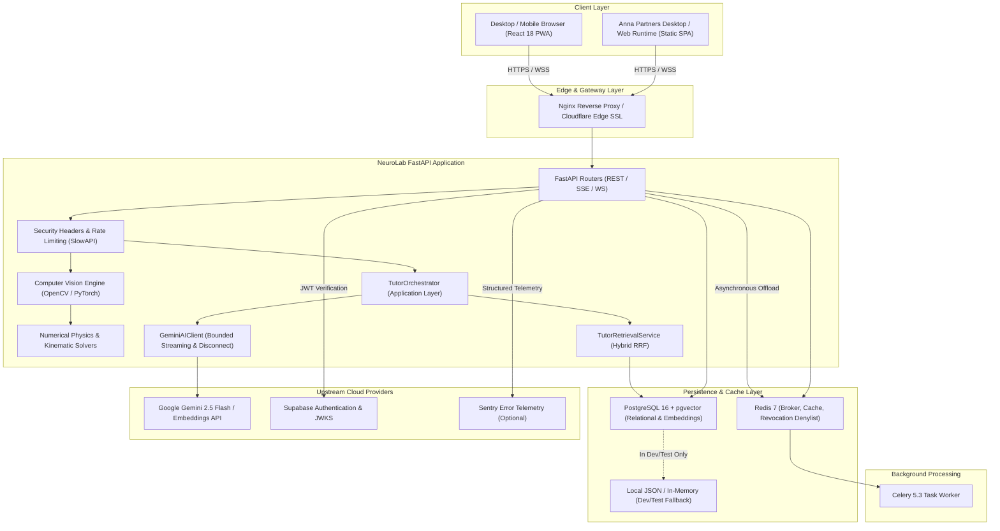

# NeuroLab AI: Production Architecture Specification

**System**: NeuroLab AI / AI Steam Lab  
**Anna App ID**: `744` (`neurolab-ai`)  
**Target Environments**: Render.com (Cloud Container), Docker Compose (On-Premises / Local), Anna Partners Embedded Runtime  
**Document Version**: 1.0.0 (Production Release Preparation)

---

## 1. High-Level System Architecture

NeuroLab AI is engineered as an **educational scientific computing platform** pairing real-time Computer Vision kinematics with an agentic Socratic AI Tutor. The system employs a **modular monolith** backend design with clear architectural boundaries, asynchronous Celery task queues, PostgreSQL relational + vector storage, Redis caching, and dual-mode React 18 client delivery (Standalone Web PWA & Anna Embedded SPA).

---

## 2. Architectural Layer Boundaries

The codebase strictly enforces unidirectional dependency flows across seven functional tiers:

### 2.1 Presentation & Client Tier (`frontend/`)
- **Technology**: React 18, TypeScript 5, Vite 5, Tailwind CSS, Recharts, Three.js / React Three Fiber.
- **Dual Build Pipelines**:
  - `npm run build`: Standard standalone web deployment with PWA service workers and absolute asset references.
  - `npm run build:anna`: Embedded runtime build generating relative asset paths (`./assets/...`) and omitting PWA service workers for native isolation inside the Anna Partners client.
- **Client Networking**: `frontend/src/lib/api.ts` targets `https://neurolab-backend-uxhv.onrender.com` in production and automatically switches to `localhost:8000` during local development.

### 2.2 Edge Gateway & Reverse Proxy (`nginx.conf`)
- **Technology**: Nginx 1.25 unprivileged alpine container.
- **Responsibilities**:
  - Terminates HTTP/1.1 and passes WebSocket connections (`Upgrade $http_upgrade`).
  - Enforces payload size restrictions (`client_max_body_size 5M`).
  - Buffering policies: Disables proxy buffering (`proxy_buffering off`) for `/api/tutor/chat/stream` to guarantee instantaneous Server-Sent Events (SSE) token delivery.

### 2.3 API Gateway & Routing Tier (`backend/app/core_backend/routes/`)
- **Technology**: FastAPI 0.136, Starlette, Pydantic v2.
- **Key Modules**:
  - `auth.py`: Authentication, MFA factor enrollment, verification, and logout token revocation.
  - `cv_tracker.py`: Real-time frame tracking, camera calibration, binary uploads, and WebSocket endpoints.
  - `experiments.py`: Experiment parameter validation, numerical simulation triggers, and history persistence.
  - `tutor.py`: Multi-turn conversational sessions, SSE streaming generation, and Socratic evaluation.
  - `gamification.py`: Server-authoritative XP ledger and tamper-proof badge verification.
  - `tasks.py`: Asynchronous background task submission, status polling, and durable result retrieval.

### 2.4 Application & Orchestration Tier (`backend/app/application/`)
- **Modules**: `tutor_orchestrator.py`, `learning_evaluation.py`.
- **Responsibilities**: Coordinates student dialogue state, queries the physics Knowledge Graph for prerequisite concept injection, enforces evaluation rubrics, and handles graceful service degradation.

### 2.5 AI & Retrieval Tier (`backend/app/ai_agent/`)
- **Modules**: `ai_client.py`, `retrieval_service.py`, `embedding_service.py`.
- **Responsibilities**:
  - Google Gemini 2.5 Flash SDK integration.
  - Single-flight deduplication and exponential retry loops for API rate-limiting resilience.
  - Hybrid Reciprocal Rank Fusion (RRF) search across 768-dimensional normalized embeddings and BM25 keywords.
  - Dedicated `ThreadPoolExecutor` offloading to prevent event loop starvation during concurrent streaming.

### 2.6 Computer Vision & Kinematic Tier (`backend/app/machine_learning/`)
- **Modules**: `cv_service.py`, `physics_engine.py`.
- **Supported Detection Modes**:
  1. **Color Segmentation (HSV)**: High-speed morphology and centroid moment extraction ($<3.0\,\text{ms}$, 370+ FPS).
  2. **Optical Flow (Lucas-Kanade)**: Pyramidal feature tracking with lost-track detection ($<2.1\,\text{ms}$, 600+ FPS).
  3. **Deep Learning (YOLOv8)**: Real-time object detection with Non-Maximum Suppression (NMS).
- **Kinematics Engine**: Central-difference numerical derivatives for velocity, acceleration, and experimental gravity calculations.

### 2.7 Persistence & Cache Tier (`backend/app/core_backend/database/`, `backend/app/cache.py`)
- **Modules**: `pgvector_db.py`, `supabase_db.py`, `migrations.py`.
- **Responsibilities**:
  - Connection pooling with bounded capacity ($C_{\text{total}} \le 150$).
  - Fail-closed production mode (`DatabasePersistenceError` on connection loss).
  - Multi-tenant data isolation enforcing `user_id` ownership across all tables.
  - Distributed Redis caching with automatic circuit breaking (`cooldown = 5.0s`).

---

## 3. Data Flow & Communication Protocols

| Communication Channel | Protocol | Security & Authorization | Typical Latency |
| :--- | :--- | :--- | :---: |
| **REST API** | HTTPS / JSON | Bearer JWT (Supabase / PyJWT) | $15 - 80\,\text{ms}$ |
| **AI Tutor Streaming** | HTTPS / Server-Sent Events (SSE) | Bearer JWT + Session Ownership | $< 1.0\,\text{ms}$ first token |
| **CV Frame Upload** | HTTPS / Multipart or Binary Octet | Bearer JWT + Session/Cam Key | $2.5 - 18\,\text{ms}$ |
| **Real-time CV Feed** | WSS (WebSocket) | Query Param JWT Verification | $16 - 33\,\text{ms}$ (30-60 FPS) |
| **Task Queue** | Redis Protocol (AMQP/Celery) | Internal VPC / Network Isolation | $< 5.0\,\text{ms}$ enqueue |

---

## 4. Fault Tolerance & Graceful Degradation

1. **Database Unavailability**:
   - In production (`ENVIRONMENT=production`): Fail-closed with `HTTP 503` to prevent uncommitted data loss.
   - In development/test: Fallback to local thread-safe JSON store (`local_stem_db.json`).
2. **Redis Outage**:
   - Redis circuit breaker detects connection failure within $1.0\,\text{s}$ and trips.
   - Cache reads and writes transparently degrade to local memory without throwing unhandled exceptions.
3. **Gemini API Outage / Quota Exhaustion**:
   - Caught at the AI client layer; returns structured `MODEL_UNCONFIGURED` or `MODEL_TIMEOUT` SSE event.
   - Socratic prompt degrades to structured template guidance; application does not crash.
4. **CV Memory Limits**:
   - In 512 MB RAM containers (e.g., Render free tier), YOLOv8 can be disabled via `ENABLE_YOLO=false`.
   - Tracker seamlessly degrades to OpenCV HSV color segmentation (`2.61 ms`, $< 150\,\text{MB}$ RAM).
